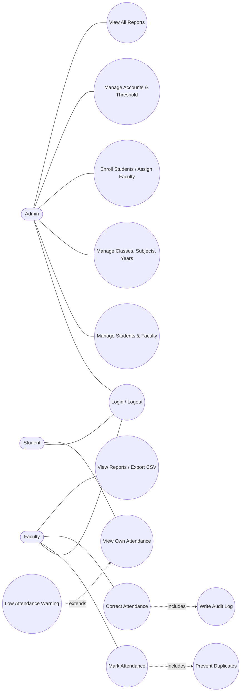
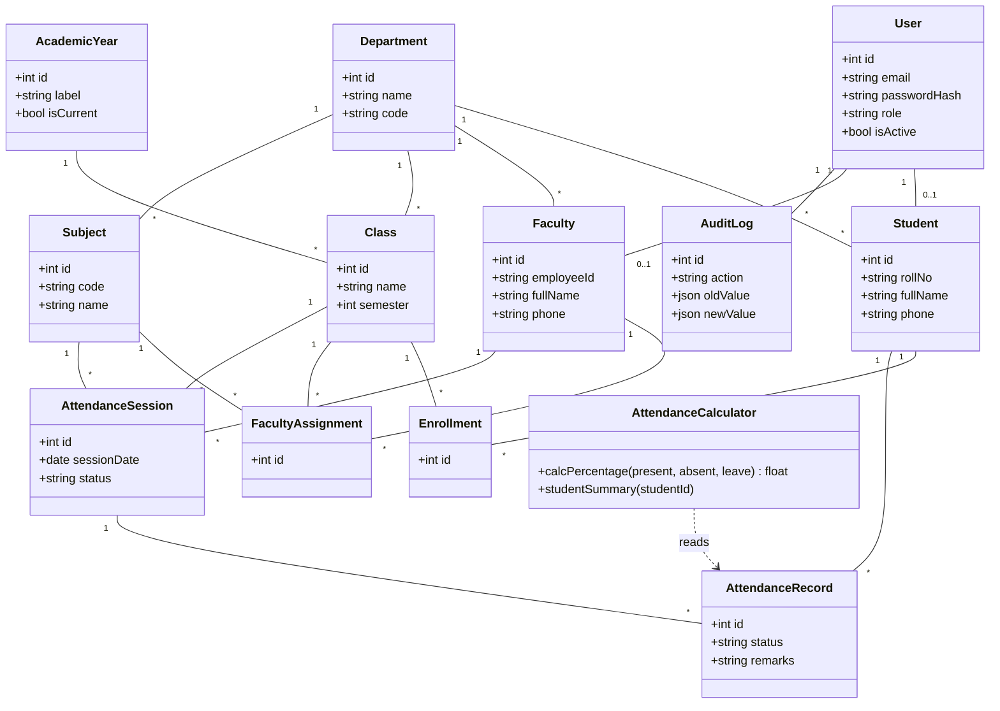
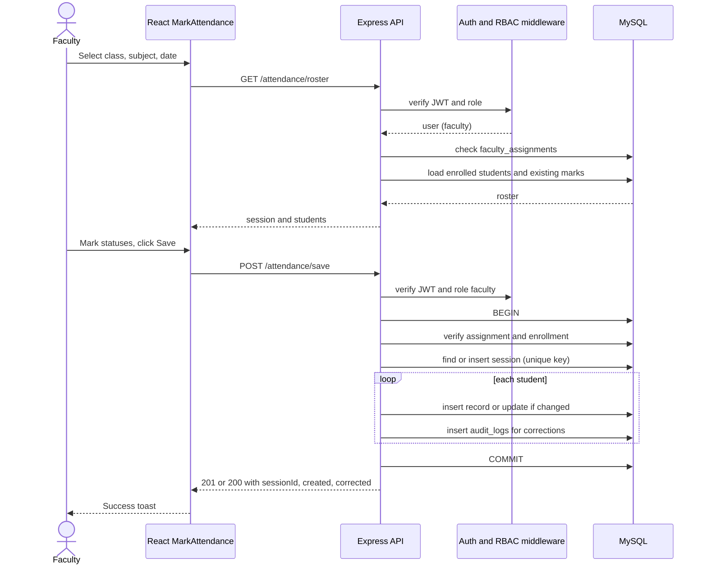
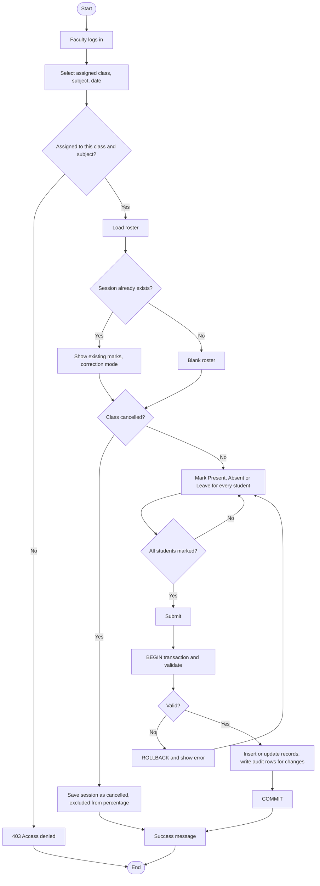
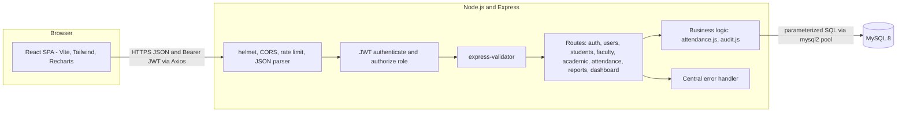
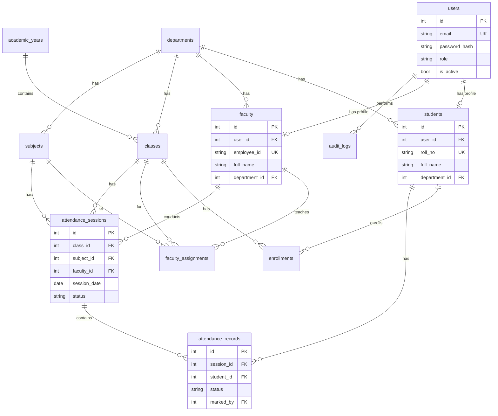
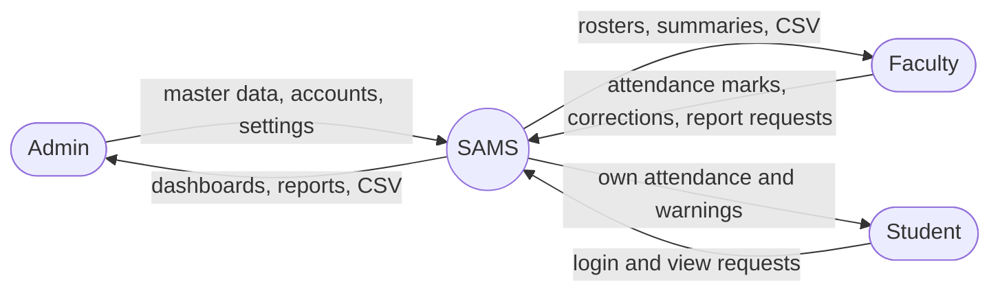
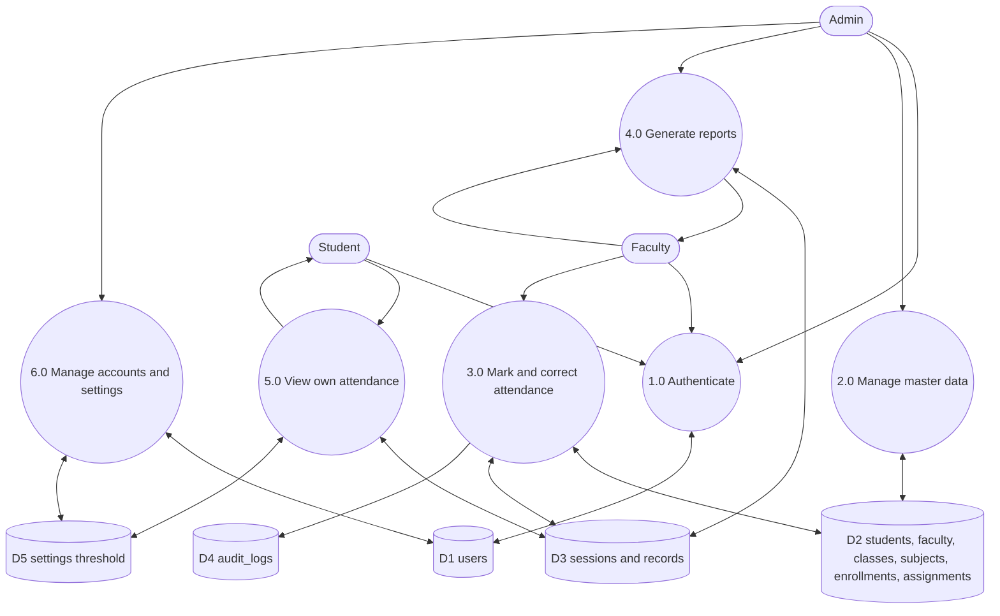

# Student Attendance Management System: Project Documentation

Render the Mermaid diagrams in VS Code (extension "Markdown Preview Mermaid Support"), on GitHub, or at https://mermaid.live.

## 1. Abstract
The Student Attendance Management System (SAMS) is a web application that replaces paper registers with a secure, role-based digital system. Admins manage students, faculty, classes, subjects and assignments. Faculty mark Present / Absent / On Leave per session, correct mistakes with a full audit trail, and export reports. Students view their own subject-wise attendance and receive a warning when they fall below a configurable threshold (default 75%). It is built with React, Express, MySQL and JWT authentication.

## 2. Problem Statement
Manual attendance is slow, error-prone, hard to total, easy to falsify, and gives students no visibility until shortages are discovered at exam time. Colleges need accurate, tamper-evident records, instant percentage calculation, and role-appropriate access.

## 3. Objectives and Scope
**Objectives:** digitise attendance; calculate percentages correctly; enforce role-based access; keep an audit history; provide reports and CSV export; give students transparency.

**In scope:** authentication, user/role management, academic structure, enrollment, faculty assignment, attendance marking/correction, dashboards, reports, audit log, threshold configuration.

**Out of scope:** biometric/QR capture, SMS/e-mail notifications, timetable generation, native mobile apps, multi-college tenancy.

## 4. Existing vs Proposed System
| Aspect | Existing (paper/Excel) | Proposed (SAMS) |
|---|---|---|
| Recording | Handwritten registers | Online roster per class/subject/date |
| Percentages | Manual calculation | Automatic, two decimals, consistent rules |
| Errors/corrections | Overwriting, no trace | Audited corrections (old/new/by/reason) |
| Access | Anyone with the register | Role-based, students see only own data |
| Reports | Slow, manual | Daily/weekly/monthly/subject-wise, CSV export |
| Alerts | None | Below-threshold warning for students |

## 5. Requirements
### 5.1 Functional requirements
| ID | Requirement |
|---|---|
| FR1 | Users log in/out securely; passwords are hashed |
| FR2 | Admin CRUD for students and faculty with search |
| FR3 | Admin manages departments, academic years, classes, subjects |
| FR4 | Admin enrolls students and assigns faculty to class+subject |
| FR5 | Admin manages accounts (create admin, enable/disable, reset password) and the attendance threshold |
| FR6 | Faculty select class, subject, date and see a searchable roster |
| FR7 | Faculty mark Present/Absent/On Leave, use Mark All Present, or mark a class cancelled |
| FR8 | Duplicate records for the same student/class/subject/date are impossible |
| FR9 | Assigned faculty can correct attendance; every change is audited |
| FR10 | Reports (daily/weekly/monthly/subject-wise) and CSV export |
| FR11 | Students see overall and subject-wise %, history, attended/missed counts |
| FR12 | Warning when attendance is below the threshold |
| FR13 | Students can only view their own records; faculty only their assigned classes |

### 5.2 Non-functional requirements
| ID | Requirement |
|---|---|
| NFR1 | Security: bcrypt, JWT, server-side RBAC, parameterized SQL, validation |
| NFR2 | Usability: responsive UI, clear errors, confirmations for destructive actions |
| NFR3 | Reliability: transactions for saving attendance; DB constraints |
| NFR4 | Performance: indexed queries; pages load quickly for ~1000 students |
| NFR5 | Maintainability: modular routes/components, documented API |
| NFR6 | Portability: runs on Windows/macOS/Linux with Node 18+ and MySQL 8 |
| NFR7 | Accessibility: labelled form fields, keyboard-friendly dialogs, contrast-safe colours |

## 6. Software Requirements Specification (summary)
- **Purpose:** define the behaviour of SAMS v1.0 for developers, evaluators and users.
- **Product perspective:** 3-tier web application (browser SPA, REST API, MySQL).
- **User classes:** Admin (full management), Faculty (marking and reports for assigned classes), Student (read-only own data).
- **Operating environment:** modern browser; Node.js 18+; MySQL 8.
- **Constraints:** stack fixed by the course (React, Express, MySQL); JWT auth.
- **Assumptions:** one faculty/student profile per account; a student must be enrolled in a class to receive attendance.
- **External interfaces:** HTTP/JSON REST API; CSV file download.
- **Business rules:** (BR1) only *held* sessions are eligible; (BR2) cancelled sessions are excluded; (BR3) leave is eligible but not present; (BR4) no future-dated attendance; (BR5) threshold default 75%.
- **Formula:** `Attendance % = present / (present + absent + leave) × 100`, 2 decimals, `0.00` when the denominator is 0.

## 7. Use Case Descriptions
| UC | Name | Actor | Main flow | Alternate / exceptions |
|---|---|---|---|---|
| UC1 | Login | All | Enter email+password, server verifies hash, JWT issued, role dashboard shown | Invalid credentials: generic error; disabled account: denied |
| UC2 | Manage students | Admin | Students page: add/edit/delete, validated, saved (user + profile in one transaction) | Duplicate roll/email: 409; invalid data: 422 |
| UC3 | Manage faculty | Admin | Same as UC2 for faculty | Faculty who already marked sessions cannot be deleted (409) |
| UC4 | Manage classes/subjects | Admin | Create departments, years, classes, subjects | Duplicate code: 409 |
| UC5 | Enroll / assign | Admin | Select class, enroll students; select faculty+class+subject, assign | Duplicate assignment: 409 |
| UC6 | Mark attendance | Faculty | Choose assigned class+subject+date, roster loads, mark each student, Save (transaction) | Unassigned: 403; empty: 400; future date: 400; unmarked: UI error |
| UC7 | Correct attendance | Faculty | Reopen same session, change statuses, add reason, Update; audit rows written | Not assigned: 403 |
| UC8 | View reports / export CSV | Faculty, Admin | Choose filters/view, table+chart, Export CSV | No data: empty state |
| UC9 | View own attendance | Student | Dashboard + details; filter by subject/date | Below threshold: warning banner |
| UC10 | Configure threshold | Admin | Users & Settings, change %, save | Outside 1-100: 422 |
| UC11 | Manage accounts | Admin | Enable/disable, reset password, create admin | Cannot disable own account |

## 8. Use Case Diagram

## 9. UML Class Diagram

## 10. UML Sequence Diagram: Marking Attendance

## 11. UML Activity Diagram: Attendance Workflow

## 12. System Architecture Diagram

## 13. Database ER Diagram

## 14. Data Flow Diagrams
### Level 0 (context)

### Level 1

## 15. Database Schema and Data Dictionary
The executable SQL is in `database/schema.sql`.

| Table | Purpose | Key columns / constraints |
|---|---|---|
| `users` | Login accounts, one per person | `email` UNIQUE, `password_hash` (bcrypt), `role` ENUM, `is_active` |
| `departments` | Academic departments | `name` UNIQUE, `code` UNIQUE |
| `academic_years` | Year labels e.g. 2025-26 | `label` UNIQUE, `is_current` |
| `classes` | A section/semester group | UNIQUE(`name`,`academic_year_id`); FK dept, year |
| `subjects` | Courses | `code` UNIQUE; FK dept |
| `students` | Student profile (1:1 with users) | `user_id` UNIQUE FK (cascade), `roll_no` UNIQUE |
| `faculty` | Faculty profile (1:1 with users) | `user_id` UNIQUE FK (cascade), `employee_id` UNIQUE |
| `enrollments` | Students to classes (M:N) | UNIQUE(`student_id`,`class_id`) |
| `faculty_assignments` | Faculty teaches subject to class | UNIQUE(`faculty_id`,`class_id`,`subject_id`) |
| `attendance_sessions` | One class meeting | UNIQUE(`class_id`,`subject_id`,`session_date`); `status` held/cancelled |
| `attendance_records` | One student's status in a session | UNIQUE(`session_id`,`student_id`); `status` present/absent/leave; `marked_by` |
| `audit_logs` | History of attendance changes and admin actions | `action`, `entity`, `old_value` JSON, `new_value` JSON, `user_id` |
| `settings` | Key/value configuration | `attendance_threshold` default 75 |

| Column | Type | Meaning |
|---|---|---|
| `attendance_records.status` | ENUM('present','absent','leave') | Student's status for the session |
| `attendance_sessions.status` | ENUM('held','cancelled') | Cancelled sessions are excluded from percentages |
| `attendance_sessions.session_date` | DATE | Date of the class (never in the future) |
| `audit_logs.old_value / new_value` | JSON | Before/after values for a correction |
| `users.password_hash` | VARCHAR(255) | bcrypt hash; plaintext is never stored |

Normalization: 3NF. Class, subject and student details are stored once and referenced by foreign keys; attendance percentages are derived, not stored.

## 16. Test Plan
**Environment:** seeded database; API at `localhost:5000`; UI at `localhost:5173`. Automated cases are in `backend/tests/`; "Manual" cases are performed in the UI.

| ID | Test case | Steps | Expected result | Type |
|---|---|---|---|---|
| T01 | Valid login | admin@college.edu / Admin@123 | 200, token, role dashboard | Auto |
| T02 | Invalid login | wrong password; unknown email | 401 "Invalid email or password" | Auto |
| T03 | Login validation | empty/invalid email | 422 with field errors; UI shows messages | Auto + Manual |
| T04 | No token | GET /students without header | 401 | Auto |
| T05 | Unauthorized role | student/faculty GET /students | 403; UI redirects to /unauthorized | Auto + Manual |
| T06 | Add student | POST valid data | 201, appears in list | Auto |
| T07 | Edit student | PUT changed name | 200, list updated | Auto |
| T08 | Invalid student data | bad email / short password | 422 and inline errors | Auto |
| T09 | Duplicate student | same email/roll | 409 | Auto |
| T10 | Delete confirmation | click delete | Confirmation dialog; cancel keeps record | Manual |
| T11 | Mark attendance | assigned faculty marks class | 201, success toast, rows saved | Auto + Manual |
| T12 | Mark All Present | click button | All rows become Present | Manual |
| T13 | Unmarked students | save with some unmarked | UI blocks with message | Manual |
| T14 | Duplicate prevention | save same session twice | Second is a 200 correction; row count unchanged; DB unique keys | Auto |
| T15 | Empty session | records = [] (held) | 400 "Cannot save an empty attendance session" | Auto |
| T16 | Future date | date in the future | 400 | Auto |
| T17 | Correction + audit | change a status, resave | `ATTENDANCE_CORRECTED` row with old/new/reason | Auto |
| T18 | Faculty restriction | save for unassigned subject | 403 | Auto |
| T19 | Percentage maths | 2 present, 1 absent | 66.67 | Auto (unit) |
| T20 | Zero sessions | no records | 0.00, no error | Auto (unit) |
| T21 | Leave handling | 3 present, 1 leave | 75.00 (leave not counted as present) | Auto (unit) |
| T22 | Cancelled class | mark session cancelled | Excluded from totals | Manual |
| T23 | Below threshold | log in as student3 | Red warning banner | Manual |
| T24 | Student privacy | student GET /attendance/student/2/summary | 403 | Auto |
| T25 | Student blocked from staff endpoints | student GET /reports/attendance | 403 | Auto |
| T26 | CSV export | Reports, Export CSV | File downloads with header row and data | Auto + Manual |
| T27 | Threshold change | admin sets 80 | Warnings use 80 | Manual |
| T28 | Responsive UI | resize to mobile width | Sidebar becomes hamburger menu; tables scroll | Manual |

Run the automated tests as described in README.md (Testing).

## 17. Implementation Details
- **Frontend:** `AuthContext` stores the user and token; `ProtectedRoute` guards pages by role; `api/client.js` (Axios) adds the Bearer token and redirects on 401; `useFetch` loads data with loading/error states; `CrudPage` + `DataTable` give searchable, sortable, paginated tables with validated modal forms and delete confirmations; Recharts draws trends and distributions.
- **Backend:** Express with `helmet`, CORS, a rate-limited login, `authenticate` (verifies the JWT then re-reads the user), `authorize(...roles)`, `express-validator` rules, and a central error handler mapping MySQL errors to safe messages.
- **Attendance save:** one transaction; assignment check; enrollment check; session upsert guarded by a UNIQUE key; per-student insert/update; audit rows for corrections; commit or rollback.
- **Percentages:** computed with SQL aggregates and `calcPercentage()`; only held sessions are used.
- **Seed:** `seed.js` hashes demo passwords with bcrypt and generates about six weeks of deterministic attendance, including cancelled sessions and low attenders.

## 18. Installation and Deployment
Local setup is in README.md. For a simple deployment: run `npm run build` in `frontend`, serve `dist/` from Nginx (or any static host) and proxy `/api` to the Node process (run it with `pm2` or a systemd service). Set a strong `JWT_SECRET`, a dedicated MySQL user with limited privileges, `CLIENT_ORIGIN` to the site URL, and enable HTTPS.

## 19. Limitations and Future Enhancements
**Limitations:** JWT in localStorage; no refresh tokens or MFA; no e-mail notifications; one session per class+subject per day; client-side pagination; no timetable integration.

**Future work:** QR/biometric/geo-fenced attendance; SMS/e-mail alerts for shortages; parent portal; timetable module; PDF reports; server-side pagination; httpOnly-cookie auth with refresh tokens; a leave-application workflow where approved leave can be excluded by policy; Docker deployment and CI tests.

## 20. Conclusion
SAMS delivers a complete, role-secured attendance workflow with correct and transparent percentage rules, database-enforced integrity, audited corrections and useful reports. It demonstrates requirement analysis, UML modelling, normalized database design, layered REST architecture, secure coding practices and test-driven verification, and leaves clear room for future extension.
